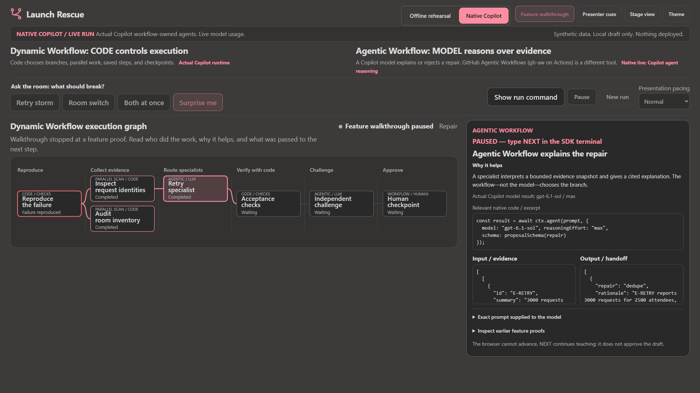

<div align="center">
  <h1>Launch Rescue</h1>
  <p><strong>Give agents a goal. Give workflows a contract.</strong></p>
  <p>An interactive GitHub Copilot demo where evidence changes the plan,<br>
  specialists challenge the result, and a human decides what happens next.</p>
  <p>
    <a href="#quickstart">Quickstart</a> &middot;
    <a href="#where-the-workflow-features-are-used">How it works</a> &middot;
    <a href="#presenter-kit">Presentation</a> &middot;
    <a href="./Feature-Research.md">Research</a>
  </p>
</div>

<p align="center">
  
</p>

<p align="center"><em>Actual native feature walkthrough: code controls the process; the agent explains a repair. Synthetic data, no deployment.</em></p>

> [!NOTE]
> This is a community demonstration, not an official GitHub product. Copilot **dynamic workflows are public preview**. The offline experience needs no account; native execution requires eligible Copilot authentication and preview access.

## Quickstart

### Try the offline demo

[Download the stage kit](https://github.com/msftnadavbh/workflows/raw/refs/heads/main/Launch-Rescue-Stage-Kit.zip), extract it, and open **`Launch-Rescue-Demo.html`** in a modern browser. Everything it needs is in that file: no installation, sign-in, or network connection.

Or clone the repository:

```powershell
git clone https://github.com/msftnadavbh/workflows.git
Set-Location workflows
```

Leave **Feature walkthrough** enabled, choose **Surprise me**, and click **Run rescue**. The demo stops automatically at each feature boundary. Read the highlighted **Dynamic Workflow** or **Agentic Workflow** proof, its code excerpt, input, and output; click **Continue walkthrough** to advance. Final draft approval is a separate action.

For an uninterrupted run, toggle **Feature walkthrough** to **Continuous run**. The same proof panel still shows the executed features.

**Used here:** JavaScript workers and deterministic checks. **No Copilot dynamic-workflow runtime or LLM calls execute in the standalone offline mode.**

### Run the native Copilot workflow

Requires **Node.js 22.12+**, a signed-in eligible Copilot account, dynamic-workflow preview access, and access to the configured models.

In the repository folder, start the observer:

```powershell
npm ci
node demo\server.mjs
```

Open **http://127.0.0.1:4173/?scoutTheme=dark** and select **Native Copilot**. In a second terminal, from the same folder:

```powershell
node native\Run-Sdk.mjs --live --pause --walkthrough --scenario mixed
```

**Used here:** the actual **Copilot dynamic-workflow runtime** plus **agentic model reasoning**. The browser observes execution; it does not start the agents or authorize native work.

> [!IMPORTANT]
> Native live runs consume **AI credits**. Type **`NEXT` in the running SDK terminal** at each feature stop. NEXT advances the explanation; it does **not** approve the draft. Only the separate final **`APPROVE`** checkpoint records local draft approval. Type **`HOLD`** to close the host without approval. Commands are case-insensitive; blank lines and typos ask again.

To exercise the actual workflow runtime **without model calls**, replace `--live` with `--rehearsal`. Omit `--pause` for a draft-only run; no human approval is then requested or claimed.

## Watch the features in the demo

These are visible, paced stops in the demo itself—not just documentation:

| Stop | Feature shown on screen | What you can inspect |
|---|---|---|
| **Choose the work** | **Dynamic Workflow** | `ctx.parallel`, measured evidence, and the code-selected specialist list. No agent has run yet. |
| **Explain a repair** | **Agentic Workflow** | The exact model prompt, cited structured response, model/effort, and the handoff into a bounded policy. Offline mode explicitly shows a JavaScript substitute. |
| **Change the next step** | **Dynamic Workflow** | The failed capacity check, new inventory, the retained retry repair, and the added capacity branch. |
| **Verify the result** | **Deterministic checks** | The actual uniqueness, capacity, and coverage checks—not a model's claim of success. |
| **Challenge the answer** | **Agentic Workflow** | The independent review prompt, verdict, rationale, and evidence provenance. |
| **Require a decision** | **Dynamic Workflow + human** | The separate approval checkpoint. After resume, the proof panel shows saved steps reused by the same run. |

The graph marks **AGENTIC / LLM**, **JS SUBSTITUTE**, **PARALLEL SCAN / CODE**, and **WORKFLOW / HUMAN** explicitly. Its highlighted nodes match the selected feature proof. **Why it helps** names the benefit, and the review proof shows both verdict rules: accept continues, reject holds. Open **Inspect earlier feature proofs** to revisit a completed step; the active proof returns when you close node inspection. The native browser never resumes or approves a run.

**“Agentic Workflow” here means agent reasoning inside the local Copilot process. It is not the separate GitHub Agentic Workflows (`gh-aw`) engine on Actions.**

## The moment to watch

The ticket launch represents **2,500 synthetic attendees**. Every fifth attendee retries. The first repair removes duplicate outcomes.

Then the room changes.

The main hall loses **200 seats after the first plan is built**. An acceptance check fails. The workflow reads the new inventory, adds the missing capacity specialist, and checks the revised candidate. It does not restart every step or wait for a new prompt.

The final reduced-capacity result is **2,300 confirmations + 200 waitlisted**, with **zero duplicate outcomes, oversold seats, or missing attendees**.

These are executable fixture results, not production capacity, latency, or cost benchmarks.

| Choose in the browser | Native `--scenario` | What the run demonstrates |
|---|---|---|
| **Retry storm** | `retries` | Retry evidence adds the identity specialist; unrelated capacity work is skipped. |
| **Room switch** | `capacity` | Stale inventory adds the capacity specialist; excess attendees are waitlisted. |
| **Both at once** | `parallel` | Two known, independent findings launch two specialists in parallel. |
| **Surprise me** | `mixed` | New evidence arrives after planning; a failed check adds a branch and a second verification. |

## Where the workflow features are used

The process is deliberately split into **orchestration**, **judgment**, **verification**, and **human review**. Not every step needs a model.

| Part of the demo | Feature actually used | How it helps | Implementation |
|---|---|---|---|
| Register and run the process | **Dynamic workflow:** `defineWorkflow`, `joinSession` | A named, reusable process replaces a one-off sequence of chat instructions. | [Native extension](./native/extension.ts) |
| Collect request and inventory evidence | **Dynamic workflow + deterministic code:** `ctx.parallel` | Independent probes overlap, then hand measured evidence to the next stage. No model is needed to count requests. | [Evidence collection](./demo/core.ts) |
| Choose which specialist joins | **Dynamic workflow:** code-defined conditions | Retry and inventory findings select only the necessary branches instead of launching every agent. | [Branch selection](./demo/core.ts) |
| Explain a bounded repair | **Agentic work:** `ctx.agent` with scoped evidence and structured output | A specialist interprets the supplied evidence and explains a permitted repair. It cannot turn its answer into arbitrary executable code. | [Analyst profile](./.github/agents/launch-analyst.agent.md) |
| React to the room change | **Dynamic workflow:** failed-check branch | The process retains the working retry repair and adds only the capacity work required by the new facts. | [Adaptive flow](./demo/core.ts) |
| Decide whether the repair worked | **Deterministic code:** allocation and contract checks | Measured outcomes, not model confidence, establish uniqueness, capacity, and coverage. | [Allocator and checks](./demo/core.ts) |
| Independently challenge the explanation | **Agentic work:** a separate reviewer model | Another model checks the candidate against current evidence and each earlier repair's immutable observation snapshot. Rejection holds the candidate. | [Reviewer profile](./.github/agents/launch-reviewer.agent.md) |
| Reuse completed work on resume | **Dynamic workflow:** versioned `ctx.step` journals | Saved JSON results can be reused when the same run resumes, avoiding repeated completed agent work. Unsaved work may run again. | [Journaled steps](./demo/core.ts) |
| Stop at the decision boundary | **Dynamic workflow + human:** `ctx.pause` | The workflow can be correct without being authorized to continue. Review happens before the local draft is approved. | [Terminal checkpoint](./native/Run-Sdk.mjs) |
| Explain execution to the audience | **Observer UI**, not an agent | The graph shows actual events, why a branch appeared, and what must happen next. Check inspection exposes the numbers behind a failure. | [Browser UI](./demo/browser.ts) |

**What makes it dynamic?** The author defines the rules in code, but inputs and findings change the path through those rules. A model does **not** invent or rewrite the orchestration program during this demo.

**What makes it agentic?** In native live mode, actual Copilot agents interpret evidence and independently challenge the result. The offline fallback substitutes ordinary JavaScript workers and says so explicitly.

### Dynamic workflows are not GitHub Agentic Workflows

| Capability | Used in this repository? | Role |
|---|---|---|
| **Copilot dynamic workflows** | **Yes, in both native modes.** | Local code-defined orchestration in the Copilot CLI/app/SDK ecosystem. |
| **Agentic work / model reasoning** | **Yes, in native live mode.** | Workflow-owned specialists and an independent reviewer. |
| **GitHub Agentic Workflows (`gh-aw`)** | **Research and presentation only; not executed.** | A separate tool that compiles Markdown with YAML frontmatter into GitHub Actions workflows. |
| **`/fleet`** | **Not used by this demo.** | Copilot chooses how to decompose a goal into subagent tasks; this demo's process is defined in code. |
| **Autopilot** | **Not required to run the demo.** | Controls agent autonomy, not the workflow's stages, permissions, or correctness. |

For repository-level triage, CI investigation, or other recurring reasoning on Actions, see [GitHub Agentic Workflows](https://github.github.com/gh-aw/). Keep deterministic builds and tests deterministic. This repository does not install, run, or deploy an Actions-based agentic workflow.

## Choose the right execution mode

| Mode | Dynamic-workflow runtime? | Model calls? | Best for |
|---|---|---|---|
| **Offline rehearsal** | **No.** Local JavaScript runner. | **No.** | A dependable presentation without sign-in or Wi-Fi. |
| **Native rehearsal** | **Yes.** Actual Copilot runtime. | **No.** | Checking registration, journals, checkpoints, and resume before a live session. |
| **Native live** | **Yes.** Actual Copilot runtime. | **Yes.** | Showing real agent reasoning and independent review, subject to availability and AI-credit usage. |

The native observer labels completed runs as completed. A previous result is not presented as a currently running model performance.

### The native agent team

| Role | Model | Reasoning | Boundary |
|---|---|---|---|
| Evidence analysis and bounded repair | **GPT-6.1 Sol** | **max** | Supplied evidence only; `tools: []`. |
| Independent challenge | **Claude Sonnet 5.5** | **high** | Supplied candidate and checks only; `tools: []`. |

The extension checks the **actual requested and resolved model** before accepting a result. An unavailable model, missing result, malformed explanation, or reviewer rejection holds the run; no silent Auto fallback is allowed.

The pinned SDK is **1.0.19**, with runtime **1.0.95**. Use the version-matched SDK runner for the checkpoint demonstration. Do not assume that independently installed CLI and SDK versions share session-storage formats.

## Presenter kit

Designed for a **2,500-person audience**, with an approximately 25-minute talk and a 6-8-minute demo segment.

| Resource | What you get |
|---|---|
| [PowerPoint](./Launch-Rescue.pptx) | 21 main-story slides, 5 hidden reference slides, speaker notes, timings, and citations. |
| [PDF backup](./Launch-Rescue.pdf) | The 21-page main story for presenting without PowerPoint. |
| [Portable stage kit](https://github.com/msftnadavbh/workflows/raw/refs/heads/main/Launch-Rescue-Stage-Kit.zip) | Presentation, standalone HTML, native extension, sources, evidence, and runbook. |
| [Presenter runbook](./Presenter-Runbook.md) | Audience vote, exact expected counts, live cues, approval boundaries, and recovery paths. |
| [Feature investigation](./Feature-Research.md) | Verified feature distinctions, preview caveats, and lessons discovered during actual live runs. |
| [Primary-source inventory](./sources/research.json) | 20 official GitHub, SDK, and VS Code sources supporting the presentation. |

Use **Stage view at 1920x1080**. The feature definitions remain visible, and the graph sits beside the selected proof. During teaching stops, the proof is the focus; measured outcomes return for final review. **Show run command** restores native setup even if an earlier run is displayed. Smaller screens remain operable by scrolling.

The Windows launcher, `.\Launch-Demo.ps1`, opens the browser only after verifying its own server is ready. Use `-Port 4180` if the default port is occupied, or `-NoBrowser` to start just the local observer.

## Explore the implementation

| Path | Responsibility |
|---|---|
| [`demo/core.ts`](./demo/core.ts) | Shared scenario logic, evidence routing, bounded repairs, immutable snapshots, and checks. |
| [`native/extension.ts`](./native/extension.ts) | Registers the actual Copilot dynamic workflow and verifies model resolution. |
| [`native/Run-Sdk.mjs`](./native/Run-Sdk.mjs) | Hosts the pinned runtime, loads scoped agents, and owns the terminal checkpoint. |
| [`demo/browser.ts`](./demo/browser.ts) | Runs offline rehearsal and observes native progress without authorizing it. |
| [`native/reconcile.ts`](./native/reconcile.ts) | Combines progress and lifecycle records without letting stale writes undo HOLD or resumed work. |
| [`tests`](./tests) | Regression coverage for calculations, branches, recovery, polling, packaging, and launchers. |
| [`.github/github-app.yml`](./.github/github-app.yml) | Copilot app project instructions and manual demo/test scripts; not a scheduled workflow. |

The compiled extension is included at [`.github/extensions/launch-rescue/extension.mjs`](./.github/extensions/launch-rescue/extension.mjs). The Windows CLI alternative is documented in the [runbook](./Presenter-Runbook.md); prefer the SDK path for the live checkpoint.

## Development and verification

Install dependencies with `npm ci`. Local regression tests also require **Python**; browser tests use an installed **Microsoft Edge**.

| Command | Coverage | Makes model calls? |
|---|---|---|
| `npm run build` | Rebuilds the standalone HTML and native extension. | No |
| `npm run typecheck` | Strict TypeScript checks against the actual SDK types. | No |
| `npm test` | Calculations, routing, recovery, lifecycle races, terminal input, server, and package regressions. | No |
| `npm run test:browser` | Scenario completion, normal-speed narration, keyboard use, reload, native observer states, and stage fit. | No |
| `npm run verify:native` | Actual native-runtime checkpoint and same-run resume. Requires eligible authentication. | No |
| `npm run verify:live` | Actual configured models, independent review, and reuse of completed agent work. | **Yes** |
| `npm run test:native-e2e` | Real agents through an actual browser observer, evidence download, terminal approval, and resume. | **Yes** |
| `npm run verify:deck` | PowerPoint structure, references, notes, and bounds. | No |
| `npm run package:stage` | Packages the kit only when native proof hashes match the current build. | No |

For browser-observed native E2E without model calls:

```powershell
node scripts\rehearse-native.mjs
```

To rebuild the presentation, run `npm run deck`. Optional slide rendering uses installed PowerPoint, `pythoncom`, `win32com`, and Pillow:

```powershell
python scripts\render-slides.py Launch-Rescue.pptx
```

Actual execution evidence is included in [`evidence/native-live-proof.json`](./evidence/native-live-proof.json), [`evidence/native-runtime-proof.json`](./evidence/native-runtime-proof.json), and [`evidence/browser-native-live-e2e.json`](./evidence/browser-native-live-e2e.json). Proofs identify the tested build with SHA-256 fingerprints; packaging rejects stale proofs and excludes private session caches.

## Safety and limitations

- **Synthetic, local-only task.** No real tickets, purchases, messages, deployments, or remote repository changes are performed by the demo.
- **Bounded agent output.** Agents propose permitted repair choices; the workflow never executes generated code. Separate semantic validation supplements the SDK's structural output checks.
- **Explicit approval.** Native checkpoints resume only in their owning host. The browser is a read-only observer; the standalone browser approval applies only to the offline draft.
- **Review extension code before trusting it.** `tools: []` restricts the agent, not arbitrary JavaScript in an extension. The local server exposes no execution or write endpoints.
- **Availability is not guaranteed.** Public-preview APIs, plan eligibility, organization policy, authentication, and model access can change. AI-credit limits are approximate, not a hard cost ceiling.

For a quick answer or a small change, a normal Copilot prompt may be enough. Use a dynamic workflow when the **process itself** needs repeatable stages, evidence-driven branches, durable results, or a clear human decision boundary.

## Documentation and feedback

[Dynamic workflow concepts](https://docs.github.com/en/copilot/concepts/agents/dynamic-workflows) &middot;
[Create, run, and resume workflows](https://docs.github.com/en/copilot/how-tos/use-copilot-agents/use-dynamic-workflows) &middot;
[SDK workflow API](https://github.com/github/copilot-sdk/blob/v1.0.19/nodejs/docs/workflows.md)

Found a problem? [Open an issue](https://github.com/msftnadavbh/workflows/issues) with the scenario, execution mode, operating system, Node/runtime versions, expected result, and sanitized error. Do not attach tokens, credentials, or unrelated session logs.
